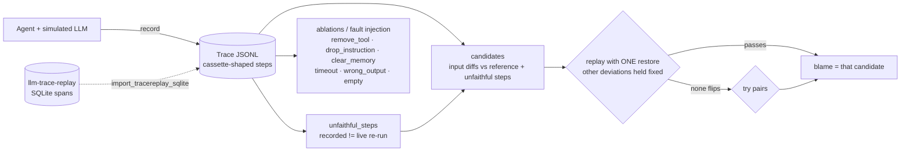

# causal-agent-evals

An eval framework that asks *why* an agent run failed, not only *whether* it failed. Given a recorded run, it does counterfactual replay (swap one tool result or input and re-run), ablations (remove a tool, an instruction or memory), fault injection (timeouts, wrong or empty tool outputs) and failure attribution (which step or input caused the failure). Attribution is measured against seeded failures with known root causes.

## What it is
- A **local trace format** (`cae/trace.py`): one JSONL file per run. Steps have the same shape as an [`llm-trace-replay`](../llm-trace-replay) cassette (`{"step", "kind": "llm.call"|"tool.call", "request", "response"}`, same `req_hash`). `import_tracereplay_sqlite()` reads that project's SQLite `spans` table with plain `sqlite3`. It does not import that project and does not need OpenTelemetry.
- A **replay engine** (`cae/replay.py`) that re-runs the agent from a trace under a list of interventions.
- **Attribution** (`cae/attribution.py`): counterfactual attribution plus three replay-free baselines.
- A **refund-desk sandbox** (`cae/world.py`): 5 tools, 3 instruction clauses, long-term memory, and a **simulated LLM** (a deterministic policy, no model weights) whose decisions really depend on those inputs. A grader scores runs against the environment's ground truth.

Example: [`examples/seeded_timeout_get_policy.jsonl`](examples/seeded_timeout_get_policy.jsonl). `get_policy` timed out, the agent fell back to a permissive default and refunded an order it should not have. A decoy (`lang` memory entry) is also present. Counterfactual attribution blames `step:3` after 2 replays.

## Why
"Pass rate went down" does not tell you what to fix. In multi-step agents the failing step is often not the step that caused the failure. A timeout three steps earlier, a stale memory entry or a missing instruction can all show up later as a bad final action. Baselines that blame the last step, or the first error they see, guess wrong in a predictable way. Interventions on a re-executable trace give a causal answer: undo this one factor and the run passes.

## Architecture


## How it works
1. **Record.** The agent talks to the world only through `sess.llm(messages)` and `sess.tool(name, args)`. Every call becomes a step. At record time, faults can be injected by step position.
2. **Faithfulness.** A recorded step is *unfaithful* if re-running the same request live (against the recorded inputs and sandbox) gives a different response. Timeouts, corrupted tool outputs and LLM sampling glitches are unfaithful. A `recall` that faithfully returned a corrupted memory entry is not: there the cause is the memory input, not the step.
3. **Candidates.** These are every instruction, memory entry or tool that differs from the reference config, plus every unfaithful step.
4. **Counterfactual replay (ceteris paribus).** Restore one candidate. Hold every other deviation fixed and re-run everything else live, so downstream effects propagate. Held tool deviations match by `(tool, args)` hash. Held LLM deviations match by step position, because an upstream change rewrites the prompt and would otherwise "fix" an exogenous glitch for free. Both rules came from bugs this benchmark found (see Results).
5. **Attribution.** The candidate whose single restore makes the run pass gets the blame. If none does, the run is overdetermined, so try pairs.
6. **Baselines.** `last_tool_step`, `first_error` (first tool result with an `error` key) and `first_anomaly` (first deviating candidate, with no replay).

```python
from cae.replay import replay
from cae.trace import Trace
t = Trace.load("examples/seeded_timeout_get_policy.jsonl")
replay(t, [{"type": "restore", "step": 3}]).final          # counterfactual
replay(t, [{"type": "drop_instruction", "id": "R1"}]).final  # ablation
replay(t, [{"type": "timeout", "step": 1}]).final            # fault injection
```

## Results
All data is **synthetic**: simulated LLM policy plus sandbox tools. Numbers come from [`results/`](results/) and are regenerated by `python3 -m cae.bench`.

### Attribution accuracy on seeded failures (exact match with the seeded root cause)
9 fault types × 20 cases. About half the cases also carry a non-causal decoy deviation. A case is kept only if the fault alone fails, the decoy alone passes, and both together fail.

| Method | Dev seed 7 (n=180) | Held-out seed 2026 (n=180) | Overdetermined pairs (n=40) |
|---|---|---|---|
| **Counterfactual replay** | **180/180 (1.000)** | **180/180 (1.000)** | **40/40 (1.000)** |
| first_anomaly (no replay) | 114/180 (0.633) | 114/180 (0.633) | 0/40 |
| first_error | 55/180 (0.306) | 48/180 (0.267) | 0/40 |
| last_tool_step | 35/180 (0.194) | 28/180 (0.156) | 0/40 |

- Cost: on average 1.51 replays per single-cause failure (max 2) and 3.0 for overdetermined ones (max 3).
- `first_anomaly` scores 88/88 without a decoy and 26/92 with one. It works only while the first deviation happens to be the cause.
- `first_error` gets timeouts right (40/40) and misses every silent fault: wrong outputs, dropped instructions, corrupted memory and LLM glitches.
- **Two replay bugs found by this benchmark.** Before the fixes, counterfactual accuracy on seed 7 was 155/180. Restoring a removed tool was undone by the hold-fixed rule (0/20 on `remove_tool:recall`). An unrelated decoy restore changed the prompt hash and silently dropped an LLM glitch (wrong blame on 5/20 `llm_wrong_arg`). One generator fix was also needed: overdetermined draws where one fault masks the other (so it is not visible in the trace) are now rejected instead of being labelled as pairs.

### Ablations on 100 clean runs ([`results/ablations.json`](results/ablations.json))
| Removed | Runs that now fail |
|---|---|
| tool `lookup_order` | 100/100 |
| tool `get_policy` | 57/100 |
| tool `issue_refund` | 31/100 |
| tool `recall` / instruction R2 / all memory | 16/100 each |
| instruction R1 (escalate above cap) | 14/100 |
| instruction R3 (delivered only) | 4/100 |
| tool `escalate` | 0/100 |

### Fault injection sweep ([`results/fault_sweep.json`](results/fault_sweep.json))
- Timeout on `lookup_order`: 100/100 runs fail. On `get_policy`: 57/100 fail, from the permissive-fallback bug. On `recall`: 16/100 fail.
- Empty output from `get_policy` fails 100/100 (the agent crashes on missing keys). Empty output from `lookup_order` fails 45/100.

## Tests
25 pytest tests:
- the clean record is faithful, and a no-op replay is identical
- trace round-trip, the cassette step shape, and import from an llm-trace-replay-style SQLite store
- counterfactual swap, timeout, ablations, and detection of unfaithful steps
- the hold-fixed rule survives a decoy restore
- every fault type is seeded and attributed correctly
- pairs are found for overdetermined runs
- bench bookkeeping, and the committed results reproduce

```bash
python3 -m pytest -q
python3 -m cae.bench        # rewrites results/*.json
```
Needs Python 3.10+ and pytest only.

## Limits
- **The 1.000 scores are an upper bound, not a field result.** The sandbox is deterministic and fully re-executable, there are at most 3 candidates per run, and the reference config is known. Real agents need sampling control (temperature 0 or seeded), tool mocks or snapshots for side effects, and a trusted reference. Their accuracy will be lower.
- Attribution blames factors that deviate from the reference. A failure caused by the reference itself (a bad canonical instruction) has no candidate, so it comes back as `unknown`.
- Pair search is capped at 50 pairs. Larger causal sets are not searched.
- Matching held LLM deviations by position assumes the trajectory length is stable up to that step.
- Only one simulated domain (refunds). No real LLM was run, to keep it cheap on a 16 GB laptop. The `sess.llm` signature matches llm-trace-replay, so a real model can be plugged in.

## License
MIT
